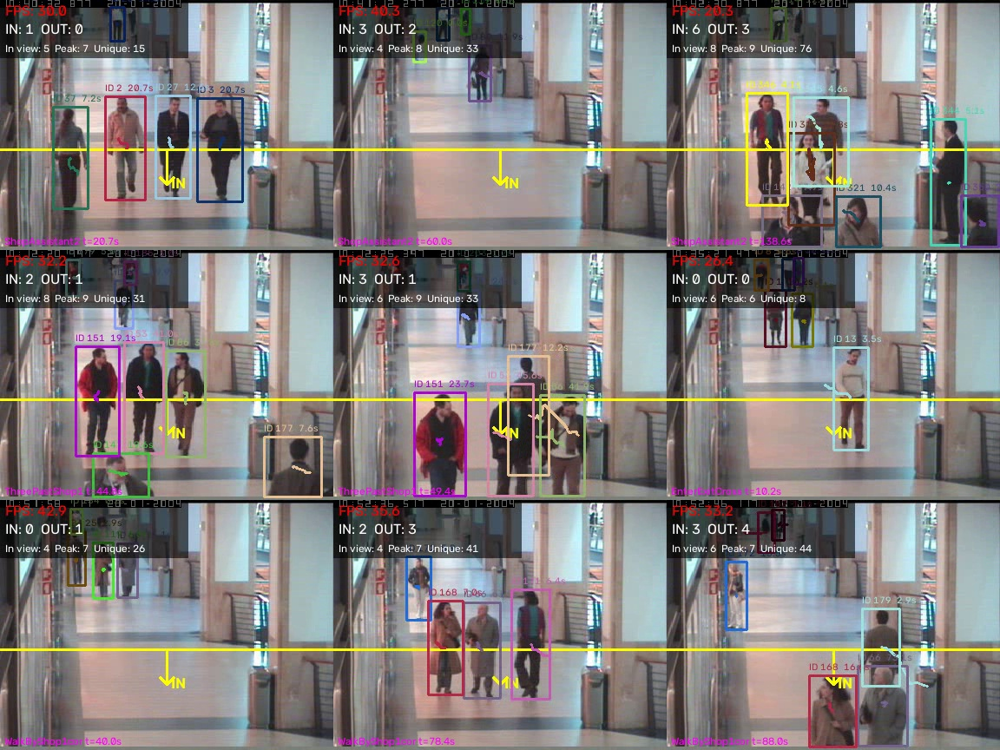

# VisionTrack

Real-time **people detection, tracking and footfall counting** in Python — built as a
study project for a retail-analytics interview.

- **Detection:** YOLO26n (Ultralytics), NMS-free, pretrained on COCO, people only
- **Tracking:** ByteTrack (Ultralytics' built-in tracker)
- **My own analytics** (`counter.py`): line-crossing IN/OUT counts using the cross-product
  sign, one count per person per direction, trails, time in frame, and people in view
  (now / peak / average / unique)
- **Experiments** (`benchmark.py`): GPU vs CPU speed, confidence threshold, and accuracy
  against hand-labelled ground truth



*Annotated frames from the CAVIAR shopping-centre corridor clips: counting line (yellow)
with IN arrow, one box + ID + time-in-frame per person, trails, and the counts panel.*

## Results at a glance

Measured on an RTX 4060 laptop GPU with 4 CAVIAR clips (5.4 min, hand-labelled ground truth).
Details: [docs/06_RESULTS.md](docs/06_RESULTS.md).

| | result |
|---|---|
| Speed (GPU) | **11.5–11.8 ms/frame ≈ 86 FPS** (CPU: 26.9–113.5 ms, varies) |
| Line crossings | **29 of 32 correct** (IN 20 / 20, OUT 11 / 12) |
| People in view | off by **0.8–1.0 people per frame** on average |
| Unique people from track IDs | over-counts **1.6–4.6×** (ID switches) — needs re-identification |

## Install (Windows, NVIDIA GPU)

Full guide with explanations: [docs/01_SETUP.md](docs/01_SETUP.md).

```powershell
py -3.12 -m venv .venv
.\.venv\Scripts\Activate.ps1
pip install -r requirements.txt     # includes the CUDA 13.2 build of PyTorch
python check_gpu.py                 # should print "CUDA available  : True"
```

No NVIDIA GPU? It still runs with `--device cpu`, just slower. Install a CPU build of
PyTorch instead of the pinned CUDA one (`pip install torch torchvision`).

## Run

```powershell
python main.py --source 0                          # webcam 0
python main.py --source sample                     # Ultralytics demo clip (downloaded once)
python main.py --source "C:\path\to\video.mp4"     # any video file
python main.py --source videos\ShopAssistant2cor.mpg --save   # also save annotated video
```

Press **q** to quit. The terminal prints each crossing and a summary; a per-person CSV
(`track_id, first_seen_s, last_seen_s, seconds_in_frame, frames_seen, direction_crossed`)
is written to `outputs/`.

### Command-line options

| option | default | meaning |
|---|---|---|
| `--source` | `1` (from `config.py`) | camera index, `sample`, a file path, or an http(s) URL |
| `--device` | `0` | `0` = first NVIDIA GPU, `cpu` = processor |
| `--conf` | `0.10` | detection confidence threshold (keep low for ByteTrack) |
| `--imgsz` | `640` | inference image size |
| `--save` | off | save the annotated video to `outputs/` |

### Counting line

Set in `config.py` as two points in **fractions of the frame** (works at any resolution):

```python
LINE_START = (0.0, 0.6)   # left edge, 60% down
LINE_END   = (1.0, 0.6)   # right edge, 60% down
```

IN = crossing from the line's negative to positive side (for a left→right line: moving
**down** the image). An on-screen arrow shows the IN direction. Swap the points to flip it.

### Experiments and tests

```powershell
python test_counter.py                       # 12 unit checks for the counting logic
python benchmark.py --experiment device      # GPU vs CPU (500 frames, 3 runs each)
python benchmark.py --experiment conf        # conf 0.10 / 0.25 / 0.50 vs ground truth
```

`benchmark.py` needs the CAVIAR clips in `videos/` and their ground-truth XML files in
`videos/ground_truth/` (see [docs/05_EXPERIMENTS.md](docs/05_EXPERIMENTS.md)). Run it on an
otherwise idle machine. Results go to `outputs/results.csv`.

## Project structure

```
VisionTrack/
├── main.py            # detection + tracking + counting on webcam / video
├── counter.py         # my analytics: line crossing, IN/OUT, trails, time in frame, occupancy
├── benchmark.py       # experiments → outputs/results.csv
├── config.py          # all settings (model, conf, image size, counting line…)
├── test_counter.py    # unit checks for counter.py
├── check_gpu.py       # verifies PyTorch can use the GPU
├── requirements.txt
├── videos/            # input videos + ground truth (git-ignored)
├── outputs/           # CSVs, results, screenshots (annotated videos git-ignored)
└── docs/              # study notes, see below
```

## Documentation

| doc | contents |
|---|---|
| [00_PROGRESS_LOG](docs/00_PROGRESS_LOG.md) | every step: commands, results, what I learned |
| [01_SETUP](docs/01_SETUP.md) | Windows install, CUDA build choice, GPU check |
| [02_HOW_YOLO_WORKS](docs/02_HOW_YOLO_WORKS.md) | grids, boxes, scores, IoU (worked example), NMS, NMS-free YOLO26 |
| [03_HOW_BYTETRACK_WORKS](docs/03_HOW_BYTETRACK_WORKS.md) | Kalman filter, IoU cost, Hungarian matching, two-stage association, thresholds |
| [04_COUNTING_LOGIC](docs/04_COUNTING_LOGIC.md) | cross product, crossings, IN/OUT, double counts, trails, time, occupancy |
| [05_EXPERIMENTS](docs/05_EXPERIMENTS.md) | experiment plan and method |
| [06_RESULTS](docs/06_RESULTS.md) | measured results and interpretation |
| [07_LIMITATIONS_AND_IMPROVEMENTS](docs/07_LIMITATIONS_AND_IMPROVEMENTS.md) | what fails, evidence, production fixes, privacy |
| [08_INTERVIEW_QA](docs/08_INTERVIEW_QA.md) | 20 likely questions with short answers |
| [TROUBLESHOOTING](docs/TROUBLESHOOTING.md) | every problem hit and how it was fixed |

## Data and credits

- **CAVIAR** test footage and ground truth: EC-funded CAVIAR project, IST 2001 37540,
  <https://homepages.inf.ed.ac.uk/rbf/CAVIARDATA1/> (not included in this repo).
- **YOLO26n** and **ByteTrack** via [Ultralytics](https://github.com/ultralytics/ultralytics)
  (AGPL-3.0).

## Privacy

Only numbers are stored (random track IDs, times, directions) — no faces or identities.
Annotated videos are git-ignored. See [docs/07](docs/07_LIMITATIONS_AND_IMPROVEMENTS.md#11-privacy).
